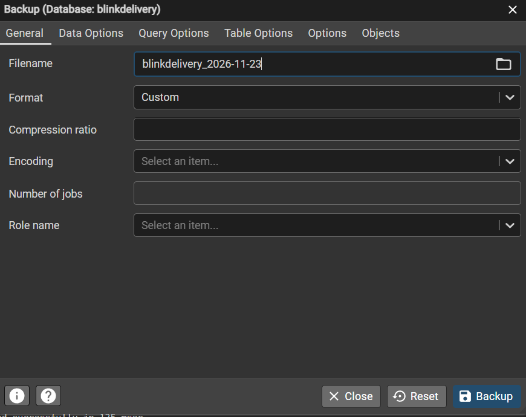

# Plan de respaldos – Blink Delivery

Proyecto Integrador de Base de Datos I · Entrega 3

Responsable de esta parte: Ednilson Contreras

## 1. Objetivo

Definir cómo se protege la información de la base de datos `blinkdelivery` ante pérdida o daño (borrado accidental, error en una migración o trigger, falla del equipo), y cómo se comprueba que esa protección funciona, restaurando los respaldos en una base aparte.

## 2. Qué se respalda

| Elemento | Detalle |
|---|---|
| Base de datos | `blinkdelivery` en PostgreSQL |
| Contenido | Esquema (11 tablas, restricciones, índices, y desde la Entrega 3, funciones y triggers) y todos sus datos |
| Tablas | `persona`, `cliente`, `domiciliario`, `direccion`, `restaurante`, `categoria`, `restaurante_categoria`, `producto`, `pedido`, `detalle_pedido`, `calificacion` |
| Fuera del respaldo | Código del repositorio (ya está versionado en Git) y archivos `.txt` de la aplicación Java |

El esquema también se puede reconstruir desde `migraciones/` y `seeds/`. El respaldo existe porque esos scripts solo recrean los datos de prueba, no los cambios hechos después sobre la base en uso.

## 3. Tipo de respaldo y herramienta

- **Tipo:** respaldo lógico completo con `pg_dump`.
- **Herramienta:** pgAdmin (opción *Backup...* sobre la base).
- **Formato:** *Custom* (archivo `.backup`), comprimido y compatible con la opción *Restore...* de pgAdmin y con `pg_restore`.
- **Nombre del archivo:** `blinkdelivery_AAAA-MM-DD.backup` (por ejemplo `blinkdelivery_2026-11-23.backup`).

Se eligió el respaldo lógico porque la base es pequeña, es portable entre equipos y versiones, y permite restaurar en una base distinta sin tocar la original.

## 4. Frecuencia

| Momento | Respaldo |
|---|---|
| Diario | Un respaldo completo al final de la jornada de trabajo |
| Antes de cambios grandes | Un respaldo adicional antes de ejecutar migraciones nuevas, crear triggers o funciones, o cargar datos masivos |
| Antes de la sustentación | Un respaldo final y su restauración probada, con la etiqueta `entrega-final` ya creada |

## 5. Retención

- Se conservan los **últimos 7 respaldos diarios**.
- Se conserva **1 respaldo semanal** durante 4 semanas.
- Los respaldos más antiguos se eliminan para no acumular archivos con datos personales sin necesidad.

## 6. Dónde se guardan

Se sigue la regla de tener al menos dos copias en lugares distintos:

1. **Copia local:** carpeta `respaldos/` en el equipo del responsable, fuera de la carpeta del repositorio.
2. **Copia externa:** almacenamiento en la nube privado o memoria USB, con acceso solo para el equipo.

Los respaldos **no se suben a GitHub** (ver sección 8).

## 7. Metas de recuperación

| Meta | Valor | Significado |
|---|---|---|
| RPO (punto de recuperación) | 24 horas | Máximo de datos que se aceptaría perder: lo hecho desde el último respaldo diario |
| RTO (tiempo de recuperación) | 30 minutos | Tiempo máximo para dejar la base funcionando de nuevo a partir de un respaldo |

## 8. Seguridad de los respaldos

El archivo de respaldo contiene los mismos datos que la base, incluyendo datos personales (nombres, teléfonos, correos) y los hashes de contraseña de `cliente.contrasena_hash`. Por eso:

- No se versionan en el repositorio. El `.gitignore` excluye `*.backup`, `*.dump` y la carpeta `respaldos/`.
- Solo los integrantes del equipo tienen acceso a la carpeta de respaldos y a la copia externa.
- Las contraseñas de conexión a PostgreSQL no se escriben en este documento ni en el código.
- Los datos del repositorio son de prueba (`seeds/`), no datos reales de personas.

## 9. Ejecución del respaldo

Se realizó un respaldo completo de la base `blinkdelivery` desde pgAdmin, con los datos semilla ya cargados.

| Dato | Valor |
|---|---|
| Fecha y hora | [23/11/2026, hora en que lo hiciste] |
| Responsable | Ednilson Contreras |
| Base respaldada | `blinkdelivery` |
| Archivo generado | `blinkdelivery_2026-11-23.backup` |
| Formato | Custom |
| Tamaño del archivo | [tamaño, míralo en las propiedades del archivo] |
| Resultado | Exitoso |

### Procedimiento

1. Clic derecho sobre la base `blinkdelivery` y elegir **Backup...**
2. En **Filename**, se indicó el nombre del archivo y en **Format**, **Custom**.
3. Se presionó **Backup** y se verificó en **Processes** que terminó con éxito.

### Comando ejecutado por pgAdmin

```text
Backing up an object on the server 'PostgreSQL 18 (localhost: 5432)' from database 'blinkdelivery'
Running command:
C:\Program Files\PostgreSQL\18\pgAdmin 4\runtime\pg_dump.exe --file "C:\\Users\\EDNILS~1\\OneDrive\\DOCUME~1\\BLINKD~2" --host "localhost" --port "5432" --username "postgres" --no-password --format=c --large-objects --verbose
```

### Evidencias

**Evidencia 1:** configuración del respaldo.



**Evidencia 2:** respaldo terminado con éxito.

